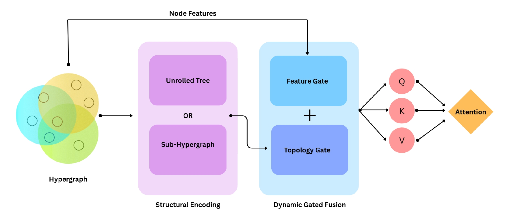

# Gated Fusion of Structure and Features for Hypergraph Attention

## Introduction

Many real-world systems involve complex higher-order interactions that are most naturally modeled using hypergraphs. Existing approaches either restrict information flow to local neighborhoods through message passing or apply global transformer attention while relying on the Hypergraph Laplacian or adjacency matrix to structure representations, which lacks the expressivity needed to capture true polyadic interactions.

To address this limitation, we propose **HyperGraph Structure Gated Fusion-Transformer (HSGF-T)**, a structure-aware transformer for hypergraph node classification built on a novel **Hypergraph Structure-Aware Self-Attention** mechanism. This mechanism learns to combine a node’s features with its structural context, dynamically balancing what the node represents and how it is connected, without relying on predefined positional encodings.

Our method is agnostic to the choice of structural encoder, which we demonstrate through two instantiations: an expressive sub-hypergraph extractor and a scalable non-linear aggregator.

We theoretically show that embedding structural information throughout the entire attention mechanism, rather than restricting it only to the attention weights, prevents representational collapse, preserves the expressivity of its structural encoder, and with the sub-hypergraph extractor exceeds 1-GWL. Empirically, we validate these guarantees by matching or outperforming strong baselines on diverse hypergraph benchmarks.



---

## Getting Started

### Dependencies

Install the PyTorch Geometric extensions (`torch-scatter` and `torch-sparse`) built for your PyTorch and CUDA versions.

Required packages:

- PyTorch >= 1.13
- Dask
- torch-geometric
- torch-scatter
- torch-sparse
- NumPy
- SciPy
- scikit-learn
- Matplotlib
- Seaborn
- Pandas
- ConfigArgParse
- pytest (for tests)

---

## Data Preparation

Download the preprocessed datasets from [Google Drive](https://drive.google.com/drive/folders/1vv-KmOUNuGqotZLtvEaX_Mck1xb--sqE?usp=drive_link).

Place the downloaded `data` directory under the root folder of this repository. The directory structure should look as follows:

```text
HSGF-T/
  <source code files>
  ...
  data/
    citeseer/
    coauthor_cora/
    cora/
    ...
```

---

## Training

Run the Cora reproduction command:

```bash
python train.py \
  --dname cora \
  --data_dir ./data/cora/ \
  --runs 10 \
  --n_layers 1 \
  --hidden_dim 256 \
  --dropout 0.7 \
  --lr 0.0008 \
  --wd 0 \
  --method HSAT \
  --mp_steps 3 \
  --w1 0 \
  --w2 0 \
  --w3 0 \
  --w4 0 \
  --w5 0 \
  --clf_layer 1
```

### Argument Description

- `--mp_steps` sets the main encoder depth (default: `2`). `--mp_steps` = K + 1, where K is the number of hops in the paper (Table 9).
- `--w1`, `--w2`, `--w3`, `--w4`, and `--w5` set the hidden-layer counts of the HSAT transformations; each defaults to `0` (identity).
- `--clf_layer` sets the classifier MLP depth; default: `1`.
- `--use_avg_gate` uses fixed equal-weight feature and structure gates instead of learned gates; off by default.
- `--pre_transform` enables the preprocessing feature transformation; enabled by default.
- `--use_rwpe` and `--use_lappe` enable Random Walk and Laplacian Positional Encodings; both are off by default.
- `--kernel` selects the attention kernel: `relu` (default, positive-feature-map linear attention) or `exp` (scaled dot-product softmax attention).
- `--mixer` selects attention (`attn`, default) or a node-wise MLP (`mlp`) for the encoder block.
- `--extract_subgraph` enables the V2 sub-hypergraph extractor; off by default.
- `--mp_steps_subhg` sets the V2 internal layer count L; default: `3`.
- `--subhg_hop` sets the V2 extraction depth K; default: `4`.
- `--subhg_encoder` selects the V2 extractor: `v1_sum` (default, V1 scatter-gather layers and Set-Union sum pooling) or `concat_proj` (the submitted Table 4 variant).
- `--subhg_max_edges` caps new hyperedges followed per frontier node and hop; `0` (default) means exact, uncapped extraction.
- `--profile_steps` profiles training steps and an evaluation pass, then exits without training the full experiment; default: `0` (disabled).
- `--feat_source` selects node features: `benchmark` (default), `structural`, `random`, or `label_trick`.
- `--feat_dim` sets the feature dimension for structural, random, and label-trick features; default: `100`.
- `--feat_seed` sets the fixed feature-generation seed; default: `0`.
- `--label_trick_rate` sets the share of training nodes whose labels are shown as inputs each epoch; default: `0.5`. The loss uses the remaining training nodes.
- `--train_prop` and `--valid_prop` set training and validation proportions; defaults: `0.5` and `0.25`.
- `--n_layers` sets transformer layers; default: `1`. `--hidden_dim` sets hidden width; default: `256`.
- `--dropout`, `--lr`, and `--wd` set dropout, learning rate, and weight decay; defaults: `0.3`, `0.0005`, and `0.00001`.
- `--runs` sets the number of runs; default: `15`. `--method` selects a model and defaults to `HSAT`.
- `--dname` selects the dataset; default: `walmart-trips-100`. `--data_dir` is required.
- `--results_tag` appends an optional result-file suffix; default: empty.

`--feat_source structural` creates degree-statistic and spectral features; `random` creates fixed Gaussian features. Neither uses labels, and these generated feature arrays are cached in the dataset's `processed/` folder. `label_trick` starts from fixed Gaussian noise and adds labels only for selected training nodes; validation and test labels are never inputs.

### Sub-hypergraph variant (V2)

```bash
python train.py --dname cora --data_dir ./data/cora/ --runs 10 --n_layers 1 --hidden_dim 256 --dropout 0.7 --lr 0.0008 --wd 0 --method HSAT --mp_steps 3 --w1 0 --w2 0 --w3 0 --w4 0 --w5 0 --clf_layer 1 --extract_subgraph
```

Keep `--mp_steps` at 2 or more with `--extract_subgraph`.

---

## Reproducing Results

Each command uses the reported settings for that dataset, along with `--runs 10 --n_layers 1 --lr 0.0008 --wd 0 --method HSAT` and `--data_dir ./data/<dname>/`.

<details>
<summary><strong>Cora</strong></summary>

```bash
python train.py --dname cora --data_dir ./data/cora/ --runs 10 --n_layers 1 --hidden_dim 256 --dropout 0.7 --lr 0.0008 --wd 0 --method HSAT --mp_steps 3 --w1 0 --w2 0 --w3 0 --w4 0 --w5 0 --clf_layer 1
```

</details>

<details>
<summary><strong>Citeseer</strong></summary>

```bash
python train.py --dname citeseer --data_dir ./data/citeseer/ --runs 10 --n_layers 1 --hidden_dim 256 --dropout 0.7 --lr 0.0008 --wd 0 --method HSAT --mp_steps 4 --w1 0 --w2 0 --w3 0 --w4 0 --w5 0 --clf_layer 1
```

</details>

<details>
<summary><strong>NTU2012</strong></summary>

```bash
python train.py --dname NTU2012 --data_dir ./data/NTU2012/ --runs 10 --n_layers 1 --hidden_dim 128 --dropout 0.2 --lr 0.0008 --wd 0 --method HSAT --mp_steps 2 --w1 1 --w2 0 --w3 1 --w4 0 --w5 1 --clf_layer 2
```

</details>

<details>
<summary><strong>Cora-CA</strong></summary>

```bash
python train.py --dname coauthor_cora --data_dir ./data/coauthor_cora/ --runs 10 --n_layers 1 --hidden_dim 256 --dropout 0.7 --lr 0.0008 --wd 0 --method HSAT --mp_steps 2 --w1 0 --w2 0 --w3 0 --w4 0 --w5 0 --clf_layer 2
```

</details>

<details>
<summary><strong>DBLP-CA</strong></summary>

```bash
python train.py --dname coauthor_dblp --data_dir ./data/coauthor_dblp/ --runs 10 --n_layers 1 --hidden_dim 512 --dropout 0.5 --lr 0.0008 --wd 0 --method HSAT --mp_steps 2 --w1 1 --w2 0 --w3 1 --w4 0 --w5 1 --clf_layer 2
```

</details>

<details>
<summary><strong>Congress</strong></summary>

```bash
python train.py --dname congress-bills --data_dir ./data/congress-bills/ --runs 10 --n_layers 1 --hidden_dim 512 --dropout 0.5 --lr 0.0008 --wd 0 --method HSAT --mp_steps 5 --w1 1 --w2 0 --w3 1 --w4 0 --w5 1 --clf_layer 2
```

</details>

<details>
<summary><strong>Mushroom</strong></summary>

```bash
python train.py --dname Mushroom --data_dir ./data/Mushroom/ --runs 10 --n_layers 1 --hidden_dim 128 --dropout 0.1 --lr 0.0008 --wd 0 --method HSAT --mp_steps 2 --w1 0 --w2 0 --w3 0 --w4 0 --w5 0 --clf_layer 1
```

</details>

<details>
<summary><strong>Walmart</strong></summary>

```bash
python train.py --dname walmart-trips --data_dir ./data/walmart-trips/ --runs 10 --n_layers 1 --hidden_dim 128 --dropout 0.2 --lr 0.0008 --wd 0 --method HSAT --mp_steps 5 --w1 2 --w2 0 --w3 0 --w4 0 --w5 2 --clf_layer 2
```

</details>

<details>
<summary><strong>ModelNet40</strong></summary>

```bash
python train.py --dname ModelNet40 --data_dir ./data/ModelNet40/ --runs 10 --n_layers 1 --hidden_dim 256 --dropout 0.1 --lr 0.0008 --wd 0 --method HSAT --mp_steps 2 --w1 0 --w2 0 --w3 0 --w4 0 --w5 0 --clf_layer 1
```

</details>

---

## Experiments in the paper and rebuttal

- Table 2 (main results): run the per-dataset commands above.
- Table 4 (V2 accuracy): add `--extract_subgraph`; `v1_sum` is the default, while `--subhg_encoder concat_proj` reproduces the submitted Table 4.
- Table 5 (attention kernels): add `--kernel exp`.
- Fig. 2(a) (hops): vary `--mp_steps`.
- Fig. 2(b) (gating): add `--use_avg_gate`.
- Appendix C.4 (positional encodings): add `--use_rwpe` and/or `--use_lappe`.
- Appendix C.7 (features): use `--feat_source random`; label-independent feature settings are `--feat_source structural` and `--feat_source label_trick`.
- Table 14 (SAT-style): add `--variant qk_clean`; encoder plus MLP: add `--mixer mlp`.
- Low-label split: add `--train_prop 0.1 --valid_prop 0.1`.
- Paired tests: `python paired_test.py TAG_A TAG_B dataset1 dataset2`.
- Gate perturbation: train with `--save_ckpt`, then run `python gate_perturbation.py --dname DATASET --tag TAG`.
- V2 cost: add `--profile_steps 20`; use `--subhg_max_edges N` for capped extraction.
- Tables 6-8 synthetic experiments:
  - `python synthetic_structure_test.py --mode all`
  - `python v1_vs_v2_structure_test.py --parts sep probe`
  - `python synthetic_fusion_test.py --parts exp1 exp2 exp3 exp4`
  - `python qk_vs_qkv_ablation.py --parts dist train`

---

## Citation

This repository is built upon the ED-GNN official repository:

- https://github.com/Graph-COM/ED-HNN
